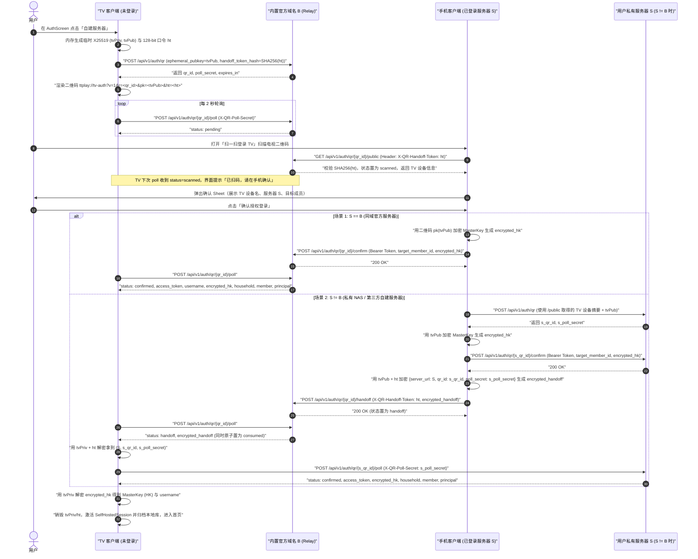
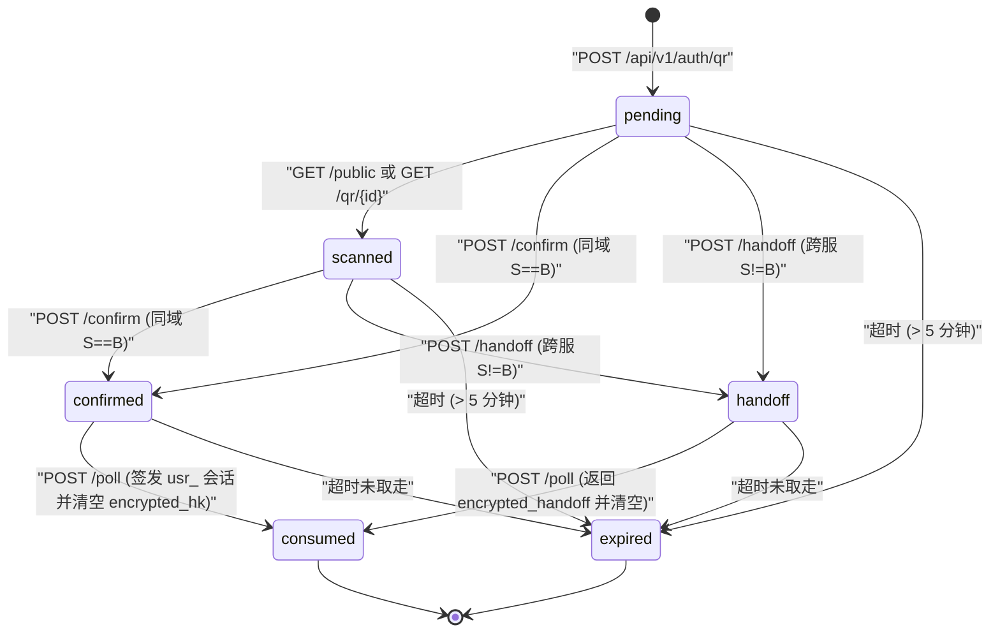

# TV 端自建服务器扫码登录设计方案

> 状态：设计定稿（待开发）　｜　日期：2026-11-27  
> 涉及模块：`media_library/`（Go）、`lib/session/`、`lib/library_cloud/`、`lib/screens/auth/`、`lib/screens/`（Flutter）、`android/` & `ios/`  
> 关联文档：[household-mount-permission-and-sync-design.md](./household-mount-permission-and-sync-design.md)、[server-sync-and-remote-control-design.md](./server-sync-and-remote-control-design.md)、[cross-platform-sync-whitepaper.md](./cross-platform-sync-whitepaper.md)

---

## 0. 一句话结论与设计目标

**以系统内置官方域名 `B` 作为「同域直连认证 + 跨服零知识盲信箱（Encrypted Rendezvous）」，并辅以「纯断外网 LAN 直连自动降级」和「手动账号密码兜底」，实现 TV 端自建服务器零输入扫码登录。**

### 核心设计目标

1. **TV 端真正零输入**：无论是连接官方域名 `B` 还是用户自己部署的任意私有 NAS `S`，TV 首次进入 `auth` 页选择「自建服务器」后直接出码，全程无需用遥控器输入服务器 URL、账号或密码。
2. **E2EE 主密钥 `MasterKey (HK)` 零知识移交**：云端媒体源（夸克、WebDAV、SMB、Emby/Jellyfin、IPTV）的凭据加密依赖客户端 256-bit `MasterKey`。TV 必须通过 `X25519 + HKDF-SHA256 + AES-256-GCM` 安全拿到 `HK`，任何服务端（包括内置官方域名 `B` 与私有服 `S`）全程无法窥探明文密钥。
3. **无惧复杂网络环境**：基于公网内置域名 `B` 的盲信箱投递，不依赖手机与 TV 同处一个局域网，彻底规避 AP 隔离、手机使用 5G 流量、多网卡防火墙拦截，甚至支持异地拍屏扫码登录；仅在 TV 完全断外网时自动降级为纯局域网 HTTP 直连投递。
4. **独立设备会话与可吊销性**：TV 获得的不是手机端 `access_token` 的复制品，而是由目标服务器 `S` 独立签发的 `usr_` 会话与 `device_class=tv` 设备记录，可在任意成员端或 Web 控制台单独踢下线。

---

## 1. 现状盘点与核心难点

### 1.1 客户端现有基础

| 能力领域 | 现有文件 / 依赖 | 当前状态 |
| :--- | :--- | :--- |
| 二维码生成与识别 | [pubspec.yaml](../pubspec.yaml) | 已内置 `qr_flutter: ^4.1.0`、`mobile_scanner: ^7.4.0`、`http: ^1.2.0` |
| 密码学原语 | [pubspec.yaml](../pubspec.yaml)、[cloud_keyring.dart](../lib/library_cloud/cloud_keyring.dart)、[lan_crypto.dart](../lib/services/companion_remote/lan_crypto.dart) | 已引入 `cryptography: ^2.9.0` 与 `crypto: ^3.0.7`，支持 `X25519`、`Hkdf(Hmac.sha256())`、`AesGcm.with256bits()` |
| 相机权限配置 | [Info.plist](../ios/Runner/Info.plist)、[AndroidManifest.xml](../android/app/src/main/AndroidManifest.xml) | iOS 已声明 `NSCameraUsageDescription`；Android 已声明 `android.hardware.camera` (`required="false"`)，兼容无摄像头的 Android TV |
| 引导与手动登录 UI | [auth_screen.dart](../lib/screens/auth_screen.dart)、[self_hosted_login_screen.dart](../lib/screens/auth/self_hosted_login_screen.dart) | 首页提供「离线模式（本地）」与「自建服务器」双入口；自建目前统一推入表单页 |
| 会话状态与存储 | [app_session_controller.dart](../lib/session/app_session_controller.dart)、[app_session_models.dart](../lib/session/app_session_models.dart)、[app_session_store.dart](../lib/session/app_session_store.dart) | `SelfHostedSession` 持久化于加密存储；`AppSessionStore.load()` 强校验 `serverUrl`、`accessToken`、`username` 均非空 |
| 云端绑定与挂载解密 | [ttplay_session_binder.dart](../lib/ttplay/ttplay_session_binder.dart) | 通过 `householdId` 非空识别 `media_library` v1 会话，并使用 `masterKeyB64` 自动解密拉取云端媒体源 |

### 1.2 服务端（`media_library`）现有基础

- **路由与 Handler**：[server.go](../media_library/internal/api/server.go) 与 [handlers_account.go](../media_library/internal/api/handlers_account.go) 已暴露：
  - `POST /api/v1/auth/qr`
  - `GET /api/v1/auth/qr/{id}`
  - `POST /api/v1/auth/qr/{id}/confirm`
  - `POST /api/v1/auth/qr/{id}/poll`
- **业务逻辑**：[qr.go](../media_library/internal/account/qr.go) 已实现 `CreateQrSession`（5 分钟 TTL、IP 限流、生成 `qrs_` 前缀一次性 `poll_secret`）、`GetQrSessionInfo`、`ConfirmQrSession`（仅限 `LoginModeHousehold`，校验 `PermManageMembers` 目标成员权限，写入 `encrypted_hk` 与 `qr.confirmed` 审计日志）、`PollQrSession`（常量时间校验 `poll_secret_hash`，原子置 `confirmed -> consumed` 并清除 `encrypted_hk`，创建设备与会话并写 `qr.consumed` 审计日志）。
- **数据库**：[migrations.go](../media_library/internal/db/migrations.go) 已建表 `qr_login_sessions`（当前最新迁移版本为 Version 8 `0008_client_logs`）。

### 1.3 需要攻克的两大核心难点

1. **自建服务器 URL 的“鸡生蛋”难题**：TV 首次打开且未登录任何服务器时，不知道用户的自建服务器地址 `S` 在哪里；若要求 TV 先输入 `S` 再向 `S` 请求 `POST /api/v1/auth/qr`，则遥控器输入一长串域名或 IP 会严重破坏扫码登录体验。
2. **E2EE 主密钥与会话上下文的跨服安全移交**：`ConfirmQrSession` 在目标服务器 `S` 上执行并生成独立 `access_token` 与 `encrypted_hk`；当 `S` 与内置官方域名 `B` 不是同一台服务器时，必须通过零知识盲信箱把 `(S, s_qr_id, s_poll_secret)` 安全送达 TV，再由 TV 自行向 `S` 完成 `poll` 验活与取票。

---

## 2. 总体架构与工作模式

记系统内置官方域名为 **`B`**（运行 `media_library`），手机端当前已登录的自建服务器为 **`S`**。TV 端启动扫码页后默认只连接 **`B`** 即可出码；手机扫码后根据 `S` 与 `B` 是否同源自动静默分流。

### 2.1 四种工作路径对比

| 路径 | 触发条件 | TV 是否需要输入 | 关键流程 | 安全与网络特性 |
| :--- | :--- | :--- | :--- | :--- |
| **模式 A1：同域直连认证** | TV 连得上 `B`，且手机登录的正是 `S == B` | **零输入** | TV 向 `B` 建 QR 会话并出码 → 手机调 `B` 的 `/public` 与 `/confirm` → TV 轮询 `B` 的 `/poll` 拿到独立 Token 与 `encrypted_hk` | 全程 TLS 公网可达，无惧 5G / AP 隔离 |
| **模式 A2：跨服零知识盲中转** | TV 连得上 `B`，但手机登录的是私有 NAS `S != B` | **零输入** | TV 向 `B` 建中转信箱并出码 → 手机向 `S` 申请并确认 `s_qr_id` → 手机用 `tvPub + ht` 加密交接包投递到 `B` 的 `/handoff` → TV 从 `B` 取回交接包后直连 `S` 调 `/poll` | `B` 看不到 `S` 地址、Token 与 `HK`，且无 `ht` 无法伪造重定向；`S` 无需升级新接口即可兼容 |
| **模式 B：纯断外网 LAN 降级** | TV 无法连接 `B`（纯内网隔离、无公网或 `B` 维护） | **零输入** | TV 降级启用本地临时 HTTP 监听 `TvQrHandoffServer` 并渲染含内网 IP 的 LAN 码 → 手机向 `S` 申请并确认 `s_qr_id` → 手机局域网并发 `/ping` 探测后 POST 加密交接包给 TV `/handoff` → TV 直连 `S` 调 `/poll` | 仅需双方同处一个可互通局域网；临时端口随用随关 |
| **模式 C：手动账号密码登录** | 无已登录手机或网络不互通 | 输入 URL / 账号 / 密码 | TV 扫码页点击「使用账号密码登录」跳转 [SelfHostedLoginScreen](../lib/screens/auth/self_hosted_login_screen.dart) | 保留原有完整登录与注册能力 |

### 2.2 总体交互时序图



---

## 3. 协议、URI 与端到端加密（E2EE）规范

### 3.1 内置域名统一配置（`BuiltinServerConfig`）

目前代码库中官方服务地址分散于多处环境变量定义：
- `PLEZY_OFFICIAL_METADATA_URL`（[server_metadata_provider.dart](../lib/library/scrapers/server_metadata_provider.dart#L120-L123)）
- `TTPLAY_RELAY_BASE_URL`（[ttplay_server.dart](../lib/services/ttplay_server.dart#L4)）
- `TTPLAY_LOG_UPLOAD_URL`（[log_upload_service.dart](../lib/services/log_upload_service.dart#L11-L14)，当前默认 `'http://123.57.195.60:20001'`）

后续需抽象统一的 `BuiltinServerConfig`（位于 `lib/session/builtin_server_config.dart`）：

1. **解析优先级**：
   1. `--dart-define=TTPLAY_OFFICIAL_BASE_URL=...`（推荐统一编译参数）
   2. 兼容回退 `PLEZY_OFFICIAL_METADATA_URL`
   3. 兼容回退 `TTPLAY_RELAY_BASE_URL`
   4. 最终默认回落值（上线正式域名前可沿用 `log_upload_service.dart` 中的线上测试服务器地址 `http://123.57.195.60:20001`，正式域名就绪后仅需修改此处一处）。
2. **同源比较规范（`isSameServerOrigin(a, b)`）**：
   - 使用 `SelfHostedSession.normalizeServerUrl` 归一化，解析为 `Uri`；
   - 比较小写的 `scheme`、小写的 `host`、标准化端口（`http` 默认 `80`，`https` 默认 `443`）与去掉末尾 `/` 的 `path`；
   - 例：`https://official.example.com/` 与 `https://official.example.com:443` 判为同源（走场景 1）。

### 3.2 二维码 URI 规范（`ttplay://tv-auth`）

二维码内容采用紧凑 URI，保证客厅 2–4 米距离、普通 TV 分辨率下也能快速对焦识别。

#### 1. Relay 主模式 URI（约 115 字符，QR Version 4–5，纠错等级 `M`）

```text
ttplay://tv-auth?v=1&r=<qr_id>&pk=<base64url(32B_tvPub)>&ht=<base64url(16B_ht)>[&b=<urlEncode(relayBaseUrl)>]
```

- 正常发版使用默认内置域名时**省略 `b` 参数**以保持二维码极致精简。
- 仅当构建时通过 `--dart-define` 覆盖了非默认测试域名时，才附加 `&b=...` 便于真机联调（但手机端若发现 `b` 与内置域名不同源，需在确认弹窗显式提示用户或校验仅在允许条件下使用，防止二维码携带恶意中继地址）。

#### 2. LAN 降级模式 URI（仅当 TV 无法连接 `B` 时生成）

```text
ttplay://tv-auth?v=1&m=lan&ips=<ip1,ip2,ip3>&p=<port>&pk=<base64url(32B_tvPub)>&ht=<base64url(16B_ht)>&dn=<urlEncode(deviceName)>&pl=<platform>&did=<deviceId>
```

#### 3. URI 参数定义表

| 参数 | 必填 | 模式 | 格式与说明 |
| :--- | :---: | :--- | :--- |
| `scheme` / `host` | 是 | 通用 | 固定 `ttplay://tv-auth`（解析时同时兼容 `plezy://tv-auth`） |
| `v` | 是 | 通用 | 协议版本号，当前固定 `1` |
| `m` | 否 | 通用 | 模式标记：`relay`（缺省默认）或 `lan` |
| `r` | Relay 必填 | Relay | 服务端返回的 `qr_id`（UUID 字符串） |
| `pk` | 是 | 通用 | TV 临时 `X25519` 公钥（32 字节原始字节的 Base64URL 无 `=` 编码，43 字符） |
| `ht` | 是 | 通用 | TV 临时 128-bit 交接口令（16 字节随机数的 Base64URL 无 `=` 编码，22 字符） |
| `b` | 否 | Relay | 可选中继基址覆盖（仅当非默认 `BuiltinServerConfig.defaultUrl` 时携带） |
| `ips` | LAN 必填 | LAN | TV 筛选后的局域网 IPv4 列表，逗号分隔，最多 3 个 |
| `p` | LAN 必填 | LAN | `TvQrHandoffServer` 监听端口（`1..65535`） |
| `dn` | 否 | LAN | TV 设备名称（UTF-8 URL 编码，如 `LivingRoomTV`） |
| `pl` | 否 | LAN | TV 操作系统平台标识（如 `android` / `ios` / `windows`） |
| `did` | 否 | LAN | TV 本地持久化 `device_id`（来自 `LanIdentityStore`） |

### 3.3 E2EE 密钥封装协议

复用 `cryptography` 库的 `X25519` + `Hkdf(hmac: Hmac.sha256(), outputLength: 32)` + `AesGcm.with256bits()`，统一封包格式如下：

#### 1. 加密步骤（发送方：手机端）
1. 从二维码 `pk` 参数解码 32 字节 `tvPub`（**绝对不能直接信任服务端接口返回的 `ephemeral_pubkey`**，必须以用户亲眼扫描的二维码里的 `pk` 为准，防止中间人或被攻破的服务器替换公钥）。
2. 生成手机端本次加密专用的临时 `X25519` 密钥对 `(phoneEphPriv, phoneEphPub)`。
3. 计算共享密钥：`shared = X25519.sharedSecretKey(keyPair: phoneEphPriv, remotePublicKey: tvPub)`。
4. 派生 32 字节对称密钥：`aesKey = HKDF-SHA256(ikm: shared, nonce: salt, info: utf8(info))`。
5. 生成 12 字节随机 `nonce`，执行 `AES-256-GCM` 加密：`box = AesGcm.encrypt(utf8(plaintextJson), secretKey: aesKey, nonce: nonce, aad: utf8(aad))`。
6. 序列化为密文 JSON 字符串：
   ```json
   {
     "v": 1,
     "alg": "x25519-hkdf-aes256gcm",
     "epk": "<base64(32B phoneEphPub)>",
     "nonce": "<base64(12B nonce)>",
     "ct": "<base64(cipherText || 16B mac)>"
   }
   ```

#### 2. 两类信封的密码学绑定参数与明文 Schema

| 信封类型 | 用途与传输载体 | HKDF `salt` | HKDF `info` | AES-GCM `aad` |
| :--- | :--- | :--- | :--- | :--- |
| **`QrHkEnvelope`** | 封装 `MasterKey`，作为 `encrypted_hk` 上传至目标服务器 `S`（含 `S == B`） | `utf8(targetQrId)` | `ttplay-qr-hk-v1` | `ttplay-qr-hk-v1:<targetQrId>` |
| **`QrHandoffEnvelope`** | 封装私有服交接凭证，作为 `encrypted_handoff` 投递给 `B` 或 LAN `/handoff` | `base64urlDecode(ht)` | `ttplay-qr-handoff-v1` | `ttplay-qr-handoff-v1:<relayQrIdOrLan>:<ht>` |

- **`QrHkEnvelope` 明文 JSON**（即使私有服 `S` 尚未升级补齐 `username`，TV 仍可由此直接还原完整会话）：
  ```json
  {
    "v": 1,
    "hk_b64": "<base64(32B MasterKey)>",
    "key_epoch": 1,
    "username": "alice",
    "server_name": "家庭影院 NAS",
    "accent_theme": "blue"
  }
  ```
- **`QrHandoffEnvelope` 明文 JSON**（因 `ht` 仅存在于二维码与手机/TV 内存中且参与 `salt` 与 `aad`，官方域名 `B` 既解密不了也伪造不了）：
  ```json
  {
    "v": 1,
    "server_url": "https://nas.example.com:8088",
    "qr_id": "550e8400-e29b-41d4-a716-446655440000",
    "poll_secret": "qrs_xxxxxxxxxxxxxxxx",
    "server_name": "家庭影院 NAS",
    "accent_theme": "blue"
  }
  ```

---

## 4. 服务端（`media_library` Go）详细设计

### 4.1 数据库迁移（Version 9：`0009_qr_handoff`）

在 [migrations.go](../media_library/internal/db/migrations.go) 现有 `0008_client_logs` 之后追加 Version 9 迁移，为 `qr_login_sessions` 表增加 4 个字段（全部具备默认值或可空，完全向后兼容）：

```sql
ALTER TABLE qr_login_sessions ADD COLUMN device_id TEXT NOT NULL DEFAULT '';
ALTER TABLE qr_login_sessions ADD COLUMN app_version TEXT NOT NULL DEFAULT '';
ALTER TABLE qr_login_sessions ADD COLUMN handoff_token_hash TEXT NOT NULL DEFAULT '';
ALTER TABLE qr_login_sessions ADD COLUMN encrypted_handoff TEXT;
```

- `handoff_token_hash`：存储 `security.HashToken(ht)`（SHA-256 hex），绝不存储 `ht` 明文。
- `encrypted_handoff`：存储手机端投递的 `QrHandoffEnvelope` JSON 字符串；被 TV `poll` 消费后立即置为 `NULL`。

### 4.2 会话状态机



**关键状态流转规则**：
1. **`scanned` 为幂等可重入状态**：手机扫码后如果用户点击“取消”，状态可停留在 `scanned`，后续再次扫码调用 `GET /public` 或 `GET /qr/{id}` 仍正常返回设备信息；`ConfirmQrSession` 与 `HandoffQrSession` 均允许前置状态为 `status IN ('pending', 'scanned')`。
2. **终态不可逆**：一旦进入 `confirmed`、`handoff`、`consumed` 或 `expired`，后续重复的 `confirm` / `handoff` 返回 `409 Conflict`；`consumed` 后再次 `poll` 返回 `409 Conflict`。

### 4.3 API 接口契约

在 [server.go](../media_library/internal/api/server.go) 路由组中保留原有 4 个接口并新增 2 个盲信箱接口：

| 方法与路径 | 鉴权方式 | 说明 |
| :--- | :--- | :--- |
| `POST /api/v1/auth/qr` | 无鉴权（IP 限流 20 次/分） | TV 创建 QR 会话（支持可选 `device_id`、`app_version`、`handoff_token_hash`） |
| `GET /api/v1/auth/qr/{id}` | `requireUser`（Bearer Token） | 同域手机获取会话详情并将 `pending -> scanned` |
| `GET /api/v1/auth/qr/{id}/public` | `X-QR-Handoff-Token`（校验 `handoff_token_hash`） | 跨服手机无需登录 `B` 获取 TV 设备摘要并将 `pending -> scanned` |
| `POST /api/v1/auth/qr/{id}/confirm` | `requireUser`（仅 `LoginModeHousehold`） | 同域手机提交 `target_member_id` 与 `encrypted_hk` |
| `POST /api/v1/auth/qr/{id}/handoff` | `X-QR-Handoff-Token`（IP 限流 30 次/分） | 跨服手机向盲信箱投递 `encrypted_handoff`（≤ 4096 字节） |
| `POST /api/v1/auth/qr/{id}/poll` | `X-QR-Poll-Secret`（校验 `poll_secret_hash`） | TV 轮询状态，消费 `confirmed` 或 `handoff` 结果 |

#### 重点新增与变更接口详情

1. **`POST /api/v1/auth/qr`**（扩展请求与响应）
   - 请求体：
     ```json
     {
       "device_class": "tv",
       "platform": "android",
       "device_name": "Living Room TV",
       "device_id": "550e8400-e29b-41d4-a716-446655440000",
       "app_version": "2.26.23",
       "ephemeral_pubkey": "<base64 or base64url 32B pubkey>",
       "handoff_token_hash": "<optional 64-hex sha256(ht)>"
     }
     ```
   - 响应体新增 `expires_in`（秒，例如 `300`），供 TV 端用本地单调计时器倒计时，避免电视盒子时钟偏移误判过期。

2. **`GET /api/v1/auth/qr/{id}/public`**（新增）
   - 请求头：`X-QR-Handoff-Token: <ht>`
   - 校验逻辑：必须存在 `handoff_token_hash` 且 `subtle.ConstantTimeCompare(HashToken(ht), handoff_token_hash) == 1`；若过期返回 `410 Gone` 或 `status: "expired"`，若非 `pending/scanned` 返回对应状态；若为 `pending` 则更新为 `scanned`。
   - 响应体：
     ```json
     {
       "code": 0,
       "qr_id": "...",
       "device_class": "tv",
       "platform": "android",
       "device_name": "Living Room TV",
       "device_id": "550e8400-...",
       "app_version": "2.26.23",
       "ephemeral_pubkey": "...",
       "status": "scanned",
       "expires_at": 1795771490000,
       "expires_in": 286
     }
     ```

3. **`POST /api/v1/auth/qr/{id}/handoff`**（新增）
   - 请求头：`X-QR-Handoff-Token: <ht>`
   - 请求体：
     ```json
     {
       "encrypted_handoff": "{\"v\":1,\"alg\":\"x25519-hkdf-aes256gcm\",\"epk\":\"...\",\"nonce\":\"...\",\"ct\":\"...\"}"
     }
     ```
   - 校验与原子更新：
     - `encrypted_handoff` 非空且长度 ≤ `4096` 字节；
     - 验证 `handoff_token_hash` 常量时间匹配；
     - IP 限流（例如每 IP 每分钟 30 次）；
     - 事务内 `UPDATE qr_login_sessions SET status = 'handoff', encrypted_handoff = ? WHERE qr_id = ? AND status IN ('pending', 'scanned') AND expires_at > ?`；影响行数为 0 时区分 `404` / `409 Conflict`；
     - 写入匿名审计日志 `Action: "qr.handoff", TargetType: "qr_session", TargetID: qrID`。

4. **`POST /api/v1/auth/qr/{id}/poll`**（扩展 `scanned` 与 `handoff` 分支）
   - `status == "pending"` 或 `status == "scanned"`：均返回 `{ "code": 0, "status": "<pending|scanned>", "expires_at": ..., "expires_in": ... }`。
   - `status == "handoff"`：在事务内原子执行 `UPDATE qr_login_sessions SET status = 'consumed', encrypted_handoff = NULL WHERE qr_id = ? AND status = 'handoff' AND expires_at > ?`，随后返回：
     ```json
     {
       "code": 0,
       "status": "handoff",
       "expires_at": 1795771490000,
       "encrypted_handoff": "{...}"
     }
     ```
   - `status == "confirmed"`：保持现有签发逻辑，做两项补齐（详见 4.4 节）。

### 4.4 `PollQrSession` 优化与向后兼容性

1. **设备复用（避免设备列表产生重复记录）**：`qr_login_sessions` 保存 TV 提交的可选 `device_id` 与 `app_version` 后，`PollQrSession` 的 `confirmed` 分支改用 [service.go](../media_library/internal/account/service.go#L833-L857) 中已有的 `upsertDeviceTx`（而非每次 `uuid.NewString()`）。这样同一台 TV 退出再扫码重登时，会更新既有设备记录的 `last_seen_at` 与 `app_version`。
2. **返回账号 `username`**：在 `QrPollResult` 与 `AuthResult` 补充 `Username string`（来自 `accounts.username`），与客户端 [AppSessionStore.load](../lib/session/app_session_store.dart#L73) 的非空校验对齐。
3. **对旧版私有 NAS `S` 的向后兼容**：
   - 在模式 A2（`S != B`）下，手机向私有服 `S` 仅调用仓库已有的 `POST /api/v1/auth/qr`、`POST /api/v1/auth/qr/{id}/confirm`、`POST /api/v1/auth/qr/{id}/poll` 三个既有接口；
   - 因 `QrHkEnvelope` 内已携带 `username`，即使私有服 `S` 尚未升级到 Version 9 迁移，TV 解密 `encrypted_hk` 后依然能拿到 `username` 完成登录。

---

## 5. Flutter 客户端详细设计

### 5.1 模块与文件清单

| 类型 | 文件路径 | 职责说明 |
| :--- | :--- | :--- |
| 新增 | `lib/session/builtin_server_config.dart` | 统一解析内置官方域名 `B`，提供 `isSameServerOrigin` 与编译期环境变量覆盖 |
| 新增 | `lib/session/tv_qr_auth_protocol.dart` | `ttplay://tv-auth` URI 编解码、Base64URL 工具、`QrHkEnvelope` / `QrHandoffEnvelope` 模型 |
| 新增 | `lib/session/tv_qr_handoff_server.dart` | 纯断外网时的 LAN 临时 HTTP 降级接收器（`/ping`、`/handoff`、局域网 IP 筛选） |
| 新增 | `lib/screens/auth/tv_self_hosted_qr_login_screen.dart` | TV 端 10-Foot 扫码登录页（支持 Relay 主模式、LAN 自动降级、倒计时与状态联动） |
| 新增 | `lib/screens/auth/mobile_qr_scan_screen.dart` | 手机端 `mobile_scanner` 相机扫码页（支持闪光灯、相册识别与异常提示） |
| 新增 | `lib/screens/auth/tv_qr_authorize_sheet.dart` | 手机端扫码后的授权确认底部 Sheet（显示 TV 信息、服务器、可选成员列表并执行加密确认） |
| 修改 | [lib/library_cloud/cloud_keyring.dart](../lib/library_cloud/cloud_keyring.dart) | 扩展 `generateX25519KeyPair`、`sealQrPayload`、`openQrPayload` |
| 修改 | [lib/session/app_session_controller.dart](../lib/session/app_session_controller.dart) | 新增 QR 创建、轮询、手机确认/跨服盲投递、LAN 降级完成登录方法 |
| 修改 | [lib/screens/auth_screen.dart](../lib/screens/auth_screen.dart) | TV 端点击「自建服务器」默认进入 `TvSelfHostedQrLoginScreen` |
| 修改 | [lib/screens/auth/self_hosted_login_screen.dart](../lib/screens/auth/self_hosted_login_screen.dart) | 桌面端增加「手机扫码登录」入口按钮 |
| 修改 | [lib/screens/discover_screen.dart](../lib/screens/discover_screen.dart) | 手机端首页右上角账号菜单在自建模式下置顶增加「扫一扫登录 TV」 |
| 修改 | [lib/screens/settings/settings_screen.dart](../lib/screens/settings/settings_screen.dart) | 手机端设置页在自建模式下同步提供「扫一扫登录 TV」入口 |
| 修改 | [lib/i18n/zh.i18n.json](../lib/i18n/zh.i18n.json)、[lib/i18n/en.i18n.json](../lib/i18n/en.i18n.json) | 补齐双语文案并运行 `slang` 生成 `strings*.g.dart` |

### 5.2 核心类与方法设计

#### 1. `CloudKeyring` 扩展（[cloud_keyring.dart](../lib/library_cloud/cloud_keyring.dart)）

```dart
class QrEphemeralKeyPair {
  const QrEphemeralKeyPair({required this.keyPair, required this.publicKeyBytes});
  final SimpleKeyPair keyPair;
  final Uint8List publicKeyBytes; // 32 bytes
  String get publicKeyBase64Url => base64UrlEncodeNoPad(publicKeyBytes);
  String get publicKeyBase64 => base64Encode(publicKeyBytes);
}

// CloudKeyring 新增静态方法：
static Future<QrEphemeralKeyPair> generateQrEphemeralKeyPair();

static Future<String> sealQrPayload({
  required Uint8List recipientPublicKeyBytes,
  required Map<String, dynamic> payload,
  required List<int> salt,
  required String info,
  required String aad,
});

static Future<Map<String, dynamic>> openQrPayload({
  required SimpleKeyPair recipientKeyPair,
  required String envelopeJson,
  required List<int> salt,
  required String info,
  required String aad,
});
```

#### 2. `AppSessionController` 扩展（[app_session_controller.dart](../lib/session/app_session_controller.dart)）

- **TV 端调用方法**：
  - `Future<TvRelayQrSession> createRelayQrSession({required String relayBaseUrl, required String tvPubKeyB64, required String handoffTokenHash})`：调用 `POST {relayBaseUrl}/api/v1/auth/qr`。
  - `Future<TvQrPollResponse> pollRelayQrSession({required String serverUrl, required String qrId, required String pollSecret})`：调用 `POST {serverUrl}/api/v1/auth/qr/{qrId}/poll`。
  - `Future<SelfHostedSession> completeSelfHostedQrLogin({required String serverUrl, required Map<String, dynamic> pollBody, required SimpleKeyPair tvKeyPair, required String qrId, SelfHostedServerBootstrap? bootstrap})`：
    1. 若 `pollBody['encrypted_hk']` 非空，调 `CloudKeyring.openQrPayload` 解出 `QrHkEnvelope`；
    2. 合并 `username`（优先 `pollBody['username']`，缺失则取信封内 `username`）、`householdId`、`memberId`、`deviceId`、`deviceClass`、`masterKeyB64`、`keyEpoch`；
    3. 构造 `SelfHostedSession` 并调用现有 `_activateSelfHostedSession(nextSession)`（自动归档本地离线库并加密持久化至 `AppSessionStore`）。
- **手机端调用方法**：
  - `Future<TvQrTargetInfo> inspectTvQrPayload(TvQrAuthPayload qr)`：
    - Relay 模式：调 `GET {relayBaseUrl}/api/v1/auth/qr/{qrId}/public`（Header 带 `X-QR-Handoff-Token`）；
    - LAN 模式：并发探测 `GET http://<ip>:<port>/ping?n={ht}`（2 秒超时取最快响应 IP）。
  - `Future<List<HouseholdMemberSummary>> listHouseholdMembersForQr()`：若当前处于自建模式，调 `GET {serverUrl}/api/v1/household/members` 返回可选成员列表（若返回非管理员或单成员则仅展示当前成员）。
  - `Future<void> authorizeTvQrLogin({required TvQrAuthPayload qr, required TvQrTargetInfo target, String? targetMemberId})`：
    - 校验 `_mode == AppLoginMode.selfHosted && _selfHostedSession != null` 且 `householdId` 与 `masterKeyB64` 非空；
    - 判断分支：
      - **`qr.isRelay && BuiltinServerConfig.isSameServerOrigin(session.serverUrl, qr.relayBaseUrl)`**（场景 1 `S == B`）：用 `qr.tvPublicKeyBytes` 封包 `QrHkEnvelope`，调 `POST {S}/api/v1/auth/qr/{qr.qrId}/confirm`。
      - **`qr.isRelay && !isSameServerOrigin(...)`**（场景 2 `S != B`）：向 `S` 调 `POST /api/v1/auth/qr` → 封包 `QrHkEnvelope` 调 `POST {S}/api/v1/auth/qr/{sQrId}/confirm` → 封包 `QrHandoffEnvelope` 投递 `POST {B}/api/v1/auth/qr/{qr.qrId}/handoff`（Header 带 `X-QR-Handoff-Token`）。
      - **`qr.isLan`**（模式 B 断外网降级）：向 `S` 申请并确认 `sQrId` → 封包 `QrHandoffEnvelope` 直连投递 `POST http://{reachableIp}:{port}/handoff`。

### 5.3 断外网 LAN 降级接收器（`TvQrHandoffServer`）

当且仅当 TV 请求内置域名 `B` 失败（超时 / `SocketException` / 5xx）时，`TvSelfHostedQrLoginScreen` 自动降级启动 `TvQrHandoffServer`：

1. **端口隔离**：绑定 `InternetAddress.anyIPv4` 端口 `0`（由系统分配临时空闲端口），**绝不与 `LanPairingService`（默认 48635）冲突**；登录成功或退出扫码页立即 `server.close(force: true)`。
2. **局域网 IP 筛选与排序**：通过 `NetworkInterface.list(type: InternetAddressType.IPv4, includeLoopback: false)` 过滤掉 `169.254.x.x` 链路本地地址及常见虚拟网卡（如 `docker`/`veth`/`tun`/`utun`），按私有网段优先级（`192.168.*` > `10.*` > `172.16–31.*`）最多保留前 3 个 IP 写入 `ips` 参数。
3. **接口定义**：
   - `GET /ping?n=<ht>`：校验 `n` 与当前 `ht` 常量时间相等，返回 `200 {"ok":true,"device_name":"...","platform":"..."}` 供手机端并发测速选路。
   - `POST /handoff`：单次锁保护（`_handoffLocked`），校验 `ht` 与解密 `QrHandoffEnvelope`，然后由 TV 立即尝试向 `server_url` 执行 `pollRelayQrSession` 与 `completeSelfHostedQrLogin`，**待 TV 确认登录成败后再向手机端返回 `200 {"ok":true}` 或 `502 {"ok":false,"error":"..."}`**，确保手机端能即时感知 TV 是否连得上私服 `S`。

### 5.4 UI / UX 交互规范

#### 1. TV 端（`TvSelfHostedQrLoginScreen`）
- **布局**：左右双栏（宽度 > 700 时横向分栏，适配 1080p/4K 10-Foot 视觉距离）。
  - **左栏**：白底圆角卡片（`padding: 16`, `borderRadius: 16`）内嵌 `QrImageView`（`size: 240`, `errorCorrectionLevel: QrErrorCorrectLevel.M`），下方是状态胶囊与倒计时文本（仅使用服务端 `expires_in` 启动本地 `Stopwatch` 递减）。
  - **右栏**：标题、三步图文/文字引导、网络模式小字提示（如「通过官方中继等待扫码」或「纯局域网直连模式 · 192.168.1.25」），以及底部垂直排列的 `FocusableButton`：
    1. **刷新二维码**（焦点默认落位，过期时高亮主按钮）
    2. **使用账号密码登录**（跳转 `SelfHostedLoginScreen`）
- **5 种页面状态**：`initializing`（骨架/加载圈）→ `waiting`（等待扫码，显示倒计时）→ `scanned`（已扫码，绿色高亮提示「请在手机上确认登录」）→ `signingIn`（正在从目标服务器完成登录与密钥解密）→ `expired` / `error`（半透明遮罩 + 一键刷新）。
- **遥控器与生命周期**：外层包裹 `Focus(onKeyEvent: (_, e) => handleBackKeyNavigation(context, e))`；页面 `dispose()` 时取消轮询 `Timer`、关闭 `TvQrHandoffServer`、置空内存中的 `tvKeyPair` 与 `ht`。

#### 2. 手机端（`MobileQrScanScreen` + `TvQrAuthorizeSheet`）
- **入口严格守卫**：仅当 `PlatformDetector.isMobile(context) && appSession?.isSelfHosted == true` 时显示入口，确保 TV/盒子端永远不会误触实例化 `MobileScanner`：
  - 首页右上角账号菜单（[discover_screen.dart](../lib/screens/discover_screen.dart#L849-L870)）：在 `selfHosted != null` 分支置顶加入 `AppMenuItem(value: 'scan_tv_login', icon: Symbols.qr_code_scanner_rounded, ...)`；
  - 设置页（[settings_screen.dart](../lib/screens/settings/settings_screen.dart)）：在自建服务器区块内增加同名入口。
- **相机页交互**：
  - 顶部悬浮返回、手电筒开关、相册选图识别入口（可选，调用 `MobileScannerController.analyzeImage`，方便家人远程发截图扫码）；
  - 权限被拒时展示带「前往系统设置」按钮的占位引导；
  - 捕获合法 `ttplay://tv-auth` 条码后立即防抖暂停识别，请求 `inspectTvQrPayload` 并在底部弹出 `TvQrAuthorizeSheet`。
- **确认授权 Sheet**：
  - 展示目标设备卡片（图标 + TV 设备名 + 平台）、即将登录的服务器名称与 URL、当前账号名；
  - 若当前账号是户主或拥有 `PermManageMembers` 且家庭存在多个活跃成员，展示成员选择器（默认选中手机当前成员）；
  - 点击「确认授权登录」展示 loading 状态，成功后显示成功提示并关闭扫码页。

#### 3. 桌面端（Windows / macOS / Linux）
- 在 [self_hosted_login_screen.dart](../lib/screens/auth/self_hosted_login_screen.dart) 表单顶部或底部增加「手机扫码登录」按钮（仅在 `!PlatformDetector.isMobile(context)` 且非 TV 默认直达时展示），复用 `TvSelfHostedQrLoginScreen`。

### 5.5 国际化 Key 规划

在 [zh.i18n.json](../lib/i18n/zh.i18n.json) 与 [en.i18n.json](../lib/i18n/en.i18n.json) 的 `session` 命名空间下新增 `qr` 子节点（示例）：

| Key | 中文 (`zh`) | 英文 (`en`) |
| :--- | :--- | :--- |
| `session.qr.tvTitle` | 扫码登录自建服务器 | Scan to Sign In |
| `session.qr.step1` | 1. 打开已登录自建服务器的手机端 TTPlay | 1. Open TTPlay on your signed-in phone |
| `session.qr.step2` | 2. 点击首页右上角账号菜单「扫一扫登录 TV」 | 2. Tap "Scan to Sign In on TV" from the account menu |
| `session.qr.step3` | 3. 扫描左侧二维码并在手机端确认授权 | 3. Scan the QR code and confirm on your phone |
| `session.qr.waitingCountdown` | 等待扫码 · 剩余 ${time} | Waiting for scan · ${time} left |
| `session.qr.scannedHint` | 已扫码，请在手机上确认登录… | Scanned! Confirm sign-in on your phone… |
| `session.qr.signingIn` | 正在连接服务器并同步密钥… | Connecting to server and syncing keys… |
| `session.qr.expired` | 二维码已过期，请刷新重试 | QR code expired. Refresh to try again. |
| `session.qr.lanFallbackNotice` | 离线外网降级：局域网直连模式（请确保同 Wi-Fi） | Offline LAN fallback mode (use same Wi-Fi) |
| `session.qr.refreshButton` | 刷新二维码 | Refresh QR Code |
| `session.qr.passwordLoginButton` | 使用账号密码登录 | Sign In with Password |
| `session.qr.scanMenuTitle` | 扫一扫登录 TV | Scan to Sign In on TV |
| `session.qr.scanMenuSubtitle` | 扫描电视屏幕上的自建服务器登录二维码 | Scan the QR code shown on your TV |
| `session.qr.confirmTitle` | 授权电视登录 | Authorize TV Sign-In |
| `session.qr.targetMemberLabel` | 授权登录成员 | Sign in as member |
| `session.qr.confirmButton` | 确认授权登录 | Authorize Sign-In |
| `session.qr.authorizeSuccess` | 已成功授权电视登录 | TV sign-in authorized |
| `session.qr.missingMasterKey` | 当前账号未解锁云端加密密钥，请重新登录后再扫码 | Cloud encryption key is locked. Sign in again first. |
| `session.qr.independentMemberUnsupported` | 当前为受限独立成员会话，无法扫码授权其他设备 | Independent member sessions cannot authorize TV sign-in |

---

## 6. 安全威胁模型与边界场景应对

### 6.1 安全威胁模型

| 威胁场景 | 攻击方式 | 防护机制 |
| :--- | :--- | :--- |
| **内置官方域名 `B` 被攻破或恶意运维窃听** | 读取 `encrypted_handoff` 或 `encrypted_hk` | 两者均由 `X25519(phoneEphPriv, tvPub)` + `AES-256-GCM` 端到端加密，`B` 没有 `tvPriv`，无法解密任何内容 |
| **`B` 篡改 TV 公钥（MITM 公钥替换）** | 改写 `GET /qr/{id}` 返回的 `ephemeral_pubkey` | 手机端**强制使用二维码明文中的 `pk` 参数**加密，不信任服务端返回的公钥副本 |
| **`B` 伪造重定向交接包（诱导 TV 连钓鱼服）** | `B` 伪造 `encrypted_handoff` 写入数据库 | `B` 仅持有 `SHA256(ht)` 而无 `ht` 明文，而 `ht` 同时作为 `QrHandoffEnvelope` 的 HKDF `salt` 与 AES-GCM `AAD`，无 `ht` 无法生成合法 GCM Tag |
| **公网扫描枚举 `/public` 或向 `/handoff` 灌脏数据** | 猜测 UUID 调用 `/public` 或 `/handoff` | 必须提供有效 `X-QR-Handoff-Token: ht`（128-bit 随机熵），且 `/handoff` 受 IP 限流及 4KB 长度限制、写入后立即锁定状态 |
| **重放攻击（重复消费已授权码）** | 截获 `poll_secret` 或重放 `/handoff` | 服务端 `WHERE status IN (...)` 原子更新 + 消费即置 `consumed` 并清空密文；TV 每次刷新生成全新密钥对与 `ht` |
| **局域网嗅探（LAN 降级模式）** | 同网段设备抓包或伪造 `/handoff` | 载荷经 `X25519 + ht + AES-256-GCM` 加密，且不包含手机自己的 `access_token` |
| **电视淘汰或丢失** | 恶意继续使用已登录 TV | TV 拥有独立 `device_id` 与 `usr_` 会话，用户在手机或 Web 端随时通过 `DELETE /api/v1/household/devices/{id}` 吊销 |

### 6.2 边界场景应对

| 边界场景 | 预期行为与处理策略 |
| :--- | :--- |
| **1. TV 处于纯断外网内网（无法访问 `B`）** | 请求 `B` 超时或失败后自动静默切换为 LAN 降级模式，启动 `TvQrHandoffServer` 出码并提示「局域网直连模式」 |
| **2. 路由器开启 AP 隔离或手机开 5G 流量** | 只要 TV 能访问公网 `B`，默认 Relay 模式即可跨网/跨运营商完成盲投递，完全不受影响 |
| **3. 跨服模式下 TV 连不上手机的私服 `S`** | 例如手机连着内网穿透/特定 DNS 或路由器未开启 NAT 回流：TV 从 `B` 取回 `S` 后立即 `poll` 失败，TV 明确展示「已收到授权，但本机无法连接服务器 `S`」并提供一键跳转 `SelfHostedLoginScreen` 预填 `S` 地址供微调 |
| **4. 电视盒子系统时间严重不准（如重置为 1970 年）** | 二维码有效期倒计时完全使用 `POST /api/v1/auth/qr` 返回的相对秒数 `expires_in` + 本地 `Stopwatch`，不依赖本地墙钟对比 `expires_at` |
| **5. 多网卡 TV 盒子（有线+Wi-Fi+VPN 虚拟网卡）** | LAN 降级模式下过滤非私有/虚拟网卡并取最多 3 个 IPv4；手机端对 `ips` 并发发起 `GET /ping`（2s 超时），取最快响应路径 |
| **6. 手机端会话缺少 `masterKeyB64`** | 扫码确认前拦截提示「当前账号未解锁云端加密密钥，请重新登录后再扫码」，避免 TV 登录后所有云端媒体源解密失败 |
| **7. 手机端为独立成员登录（`LoginModeMemberOnly`）** | 服务端 `ConfirmQrSession` 禁止独立成员为家庭授权登录；手机端入口或授权前给出明确提示（需使用家庭主账号登录后再扫码） |
| **8. 手机扫码后点击取消，随后重新扫描同一二维码** | `pending -> scanned` 允许重复扫描且支持从 `scanned` 执行 `confirm` / `handoff`，TV 无需刷新即可继续完成登录 |
| **9. 私有服 `S` 尚未升级（无 `0009_qr_handoff` 迁移）** | 完全兼容：场景 2 对 `S` 仅调用既有 3 个接口，且 `username` 已内嵌于 `QrHkEnvelope` |

---

## 7. 分阶段实施路线与测试验收清单

### Phase 1：Go 服务端（`media_library`）
- **开发任务**：
  1. [migrations.go](../media_library/internal/db/migrations.go) 新增 Version 9 `0009_qr_handoff`。
  2. [qr.go](../media_library/internal/account/qr.go) 扩展 `CreateQrSession`、`GetQrSessionInfo`（及新增 `GetQrPublicInfo`）、`HandoffQrSession`、`PollQrSession`（支持 `scanned`/`handoff`、复用 `upsertDeviceTx`、补齐 `Username`）。
  3. [handlers_account.go](../media_library/internal/api/handlers_account.go) 与 [server.go](../media_library/internal/api/server.go) 注册 `GET /api/v1/auth/qr/{id}/public` 与 `POST /api/v1/auth/qr/{id}/handoff`。
- **测试验收**：
  - 在 [account_test.go](../media_library/internal/account/account_test.go) 与 `api_s1_test.go` 新增单元测试与 HTTP 集成测试：覆盖 `pending -> scanned -> confirmed`、`pending -> scanned -> handoff -> consumed`、错误 `X-QR-Handoff-Token` 拒签、`handoff` 负载超 4KB 拒收、重复消费返回 `409`、同一 `device_id` 重登不产生重复设备记录；
  - 执行 `go test ./...` 全量通过。

### Phase 2：Flutter 协议、加密与 Session 层
- **开发任务**：
  1. 实现 `BuiltinServerConfig`、`TvQrAuthProtocol`、`TvQrHandoffServer`。
  2. 扩展 `CloudKeyring` 的 `X25519 + HKDF-SHA256 + AES-256-GCM` QR 加解密方法。
  3. 扩展 `AppSessionController` 的 TV 端轮询/激活与手机端探测/确认方法。
- **测试验收**：
  - `TvQrAuthProtocol` 单元测试（Relay/LAN URI 编码、非法参数、特殊字符设备名解析）；
  - `CloudKeyring` QR 加解密单元测试（正反向加解密、篡改 `aad`/`ht`/`qrId` 验证解密必然失败）；
  - `AppSessionController` Mock HTTP 测试（分别验证 `S == B`、`S != B` 跨服盲中转、`poll` 返回空 `username` 时由信封兜底补齐、离线本地库归档触发）。

### Phase 3：Flutter UI 接入、国际化与真机联调
- **开发任务**：
  1. 实现 `TvSelfHostedQrLoginScreen`、`MobileQrScanScreen`、`TvQrAuthorizeSheet`。
  2. 接入 [auth_screen.dart](../lib/screens/auth_screen.dart)、[self_hosted_login_screen.dart](../lib/screens/auth/self_hosted_login_screen.dart)、[discover_screen.dart](../lib/screens/discover_screen.dart)、[settings_screen.dart](../lib/screens/settings/settings_screen.dart)。
  3. 更新 `zh.i18n.json` / `en.i18n.json` 并生成翻译代码。
- **测试验收**：
  - Widget 测试：验证 TV 焦点切换、倒计时过期遮罩与刷新按钮、`AuthScreen` 在 TV vs Mobile 下的路由分流；
  - 执行 `flutter analyze` 与相关 `flutter test` 无报错；
  - 真机联调矩阵：
    1. Android TV + 手机（同 Wi-Fi，登录内置官方服 `B`）；
    2. Android TV + 手机（手机切 5G 流量，登录私有 NAS `S != B`）；
    3. Android TV + 手机（拔掉外网仅内网连通，验证 LAN 自动降级）；
    4. 登录后验证 TV 端云端媒体源自动解密挂载、播放续播及在手机端「设备管理」中单独踢出该 TV。
